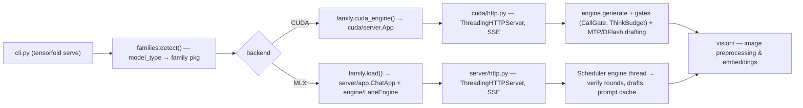

# Repository Guidelines

## Project Overview

Patched **TensorFold** LLM inference engine (v0.6.2, Apache-2.0, unofficial fork) that serves
`qwen3_5_moe`-family checkpoints — Qwen3.6-35B-A3B and the Sage-A1.5 finetune — on a DGX Spark GB10
with **image input** (the fork's vision patch) and **MTP speculative drafting**. The repo also ships a
deployment recipe for the retrieval pair (Qwen3-Embedding-0.6B + Qwen3-Reranker-0.6B) on stock vLLM.
Two backends: **MLX** (Apple Silicon) and **CUDA** (NVIDIA, torch/triton from the NGC container).
Exposes an OpenAI-compatible HTTP API (`/v1/chat/completions`, `/v1/completions`, `/v1/responses`,
`/v1/models`, `/metrics`).

## Architecture & Data Flow

Plugin **family registry** + versioned kernels + two server stacks:



- **`src/tensorfold/families/`** — one package per model family, discovered by checkpoint
  `model_type` (`families/__init__.py`: `Family`, `families()`, `detect()`, `load()`).
  A family declares module constants (`MODEL_TYPES`, `TITLE`, `LANES`, `DRAFTER`, `KERNEL_PACKAGE`, …)
  and optional functions `check()`, `load()` (MLX), `cuda_engine()` (CUDA).
- **`src/tensorfold/engine/`** — shared decoding machinery: prefill chunking, speculative verify
  rounds, exact position-keyed sampling (`exact_sampling.py`, `gpu_sampling.py`), grammar masks,
  tool-call gating (`call_gate.py`), prefix caches and admission control.
- **`src/tensorfold/cuda/`** — CUDA server (`server.py App`, `http.py`), scheduling, precision,
  JIT kernel builds (`build.py` compiles shipped `*.cu` via torch on first use), EXL3/NVFP4 readers.
- **`src/tensorfold/server/`** — MLX HTTP server and the request layer both servers share
  (routing, SSE, prompt blocks, tools, stopping, errors, metrics).
- **`src/tensorfold/vision/`** — this fork's patch area: image preprocessing (`qwen_processing.py`,
  shared CPU path), CUDA image features (`qwen_cuda.py`, env `TENSORFOLD_VISION_WEIGHTS`), validation
  (`config.py`, `--vision` wiring in `serve_options.py`).
- **`src/tensorfold/drafters/`** — DFlash2 drafting (vendored z-lab model under
  `drafters/vendor/z_lab_dflash/`) + session n-gram blend + `calibration.py`
  (data: `families/qwen3_5/dflash2_calibration.json`).
- **`src/tensorfold/kernels/`** — Metal kernels as Python string templates, versioned
  `kernels/<family>/<variant>/v1/`; **`src/tensorfold/streaming/`** — expert streaming from
  checkpoint into a GPU slot pool (C++/nanobind `hostsync/`, built on first use).

**Request flow (CUDA)**: `cuda/http.py` → `App.prepare()` (chat template, vision, sampling) →
`App.run()` → `generate_gated()` around `engine.generate()` (family engine, CUDA graphs) → SSE deltas.
**MLX**: `server/http.py` → `ChatApp.chat()` → `Scheduler` engine thread → `LaneEngine` verify rounds
→ SSE. Startup: `cli.main()` → `cmd_serve()` (cli.py) → hub resolves weights →
`serve_options.check()` refuses unsupported flags *before* any download → family/engine load.

## Key Directories

| Path | Purpose |
|---|---|
| `src/tensorfold/` | The engine; copied verbatim into the container (all first-party code) |
| `src/tensorfold/families/qwen3_5_moe/` | The fork's focus: Qwen3.6 MoE CUDA engine, MTP, decode graphs |
| `src/tensorfold/drafters/vendor/`, `families/deepseek_v4/vendor/` | Third-party code — **never edit or reformat** |
| `deploy/` | `bootstrap.sh` (provision weights + image), `provision.sh` (phased provisioning: download/fix/build/run, `--help`), `docker-compose.yml` (4 services), `check-retrieval.sh` |
| `assets/` | Benchmark PNGs referenced by README |
| `LICENSES/`, `NOTICE`, `THIRD_PARTY_NOTICES.md` | Apache-2.0 + provenance of adapted code (mlx-lm, transformers, z-lab, ExLlamaV3 ports) |

## Development Commands

```bash
# Build the engine image (engine changes only take effect here — source is COPYed into dist-packages)
docker build -t dgx-spark-tensorfold:0.6.2-moe-vision .

# One-time provisioning: downloads ~44 GB of weights into ./models, patches configs, builds image
bash deploy/bootstrap.sh                       # HF_ENDPOINT defaults to https://hf-mirror.com

# Full stack: qwen36 :8000, sage :8007, embed :8004, rerank :8005 (all host networking)
docker compose -f deploy/docker-compose.yml up -d

# Smoke-test the retrieval pair (EMBED_URL/RERANK_URL overridable)
bash deploy/check-retrieval.sh

# Engine CLI (console script `tensorfold` or python -m tensorfold)
tensorfold serve /models/Sage-A1.5-MLX-4bit --vision --parallel 8 --kv-dtype bf16 --context 126976

# Lint / test (local dev)
pip install -e ".[test,vision]"   # extras: test, vision, grammar, ssd
ruff check .                      # line-length 120; vendor dirs excluded
pytest                            # testpaths=["tests"] — see Testing & QA
```

## Code Conventions & Common Patterns

- **Synchronous only**: no `asyncio` anywhere. `ThreadingHTTPServer` per connection + one engine
  worker thread (`server/scheduler.py`, thread name `tensorfold-engine`) + `threading.Event/Lock/Queue`.
- **No `logging` module**: `print(f"[tensorfold] …", flush=True)`; optional request log via
  `TENSORFOLD_REQUEST_LOG`; live terminal line in `server/live.py` (disable with `TENSORFOLD_NO_LIVE=1`).
- **Lazy heavy imports**: `mlx`/`torch`/`triton` are imported *inside functions* so every module
  imports on any platform (see `engine/family_common.py`, `cuda/build.py`). Follow this — never add
  top-level GPU imports.
- **Family plugin contract**: extend via module constants + optional `load()`/`cuda_engine()`/`check()`
  discovered with `getattr` — no ABCs/Protocols; capability checks over inheritance.
- **Errors**: `server/errors.py` — `RequestError(ValueError)` → HTTP 400, `CapacityError` → 503,
  `ContextLengthError`. CLI misuse → `ValueError`; `cli.main()` prints `tensorfold: …` to stderr, exit 1.
- **Typing**: `from __future__ import annotations` everywhere; PEP 604 unions; `dataclass(slots=True/
  frozen=True)` for value objects; `typing.Any` for engines/models.
- **Style**: snake_case modules/functions, PascalCase classes, UPPER_CASE module constants;
  one-line module docstrings; line length 120 (ruff); load-bearing inline comments are the norm.
- **Env vars as tuning knobs**: `TENSORFOLD_*` (server/engine: `TENSORFOLD_MEMORY_LIMIT_GB`,
  `TENSORFOLD_SEED_SALT`, `TENSORFOLD_NO_UPDATE_CHECK`, …) and `TF_*` (drafter/kernel tuning:
  `TF_DRAFT_LOG`, `TF_MOE_ROWS`, `TF_MTP_ROUNDS`, …). Family `MLX_ENV` is applied with
  `os.environ.setdefault` **before** MLX import.
- **Vendored/generated code**: `vendor/` dirs are verbatim third-party (ruff-excluded; changes live in
  the importing module, e.g. `drafters/dflash_drafter.py`). `dflash2_calibration.json` is generated
  (provenance inside the file). CUDA/Metal/C++ extensions build from shipped sources on first use —
  never commit build artifacts.

## Important Files

- `pyproject.toml` — single source of truth: deps (platform-gated), extras, ruff, pytest, package-data.
- `src/tensorfold/cli.py` — entry point (`tensorfold` console script); serve/pull/models/info/update.
- `src/tensorfold/families/__init__.py` — family discovery + checkpoint compatibility checks.
- `src/tensorfold/serve_options.py` — refuses unsupported flag/backend/family combos early.
- `Dockerfile` (root, 5 lines) — NGC `pytorch:26.07-py3` base (overridable at build: `--build-arg BASE_IMAGE=<ref>`); source copied into site-packages;
  adds `transformers>=5.3,<6` (without it the first image request dies with `ModuleNotFoundError`).
- `deploy/docker-compose.yml` — service/ports/memory budget for the two-model + retrieval layout.
- `README.md` — quickstart, measured performance, checkpoint quirks (Sage stop-token patch,
  shared 475 MB `mtp-4bit.safetensors`, reranker seq-cls conversion).

## Runtime/Tooling Preferences

- **Python ≥3.11** (container runs 3.12); **setuptools** src-layout; version is dynamic from
  `src/tensorfold/__init__.py` (`__version__ = "0.6.2"`).
- **Platform-gated deps**: `mlx`/`mlx-lm` are macOS-only; on Linux **torch/triton come from the NGC
  container**, not pip. `transformers>=5.3,<6`, `nanobind==3.0.1` (macOS `ssd`), `mlx<0.32.4` are
  hard pins — respect them.
- **Docker is the supported path** on DGX Spark (native 1.1.2 build is slower and rejects images).
  Models are bind-mounted read-only from `/models`; serving runs offline (`HF_HUB_OFFLINE=1`).
- Context values (`126976` README / `114688` / `118784` compose) are memory-budgeted for two 35B
  models resident; if startup refuses the window, use the value from its
  `estimated largest fitting ... window` message.

## Testing & QA

- **No tests ship in this fork.** `pyproject.toml` configures pytest (`testpaths = ["tests"]`,
  `pythonpath = ["src", "tests"]`, extra `test = ["pytest>=8"]`), but `tests/` is absent — it lives in
  upstream TensorFold. Source comments cite upstream tests (e.g. `tests/test_dflash_draft_vocab.py`
  pins `SUB_HEAD_TOLERANCE` in `drafters/dflash_drafter.py`); treat those as documentation, do not
  invent replacements for them.
- **Runnable QA today**: `ruff check .` (no formatter/type-checker configured; no CI, no Makefile) and
  the smoke scripts — `deploy/check-retrieval.sh` for the retrieval pair, `curl -s localhost:<port>/v1/models`
  plus a chat completion for the engines.
- **Verification bar for changes**: exercise the real path — build the image (`docker build`) and hit the
  endpoint; engine edits are invisible until rebuilt. For vision changes, send an actual image
  (`{"type":"image_url","image_url":{"url":"data:image/png;base64,..."}}`) and check the answer, not just a 200.
